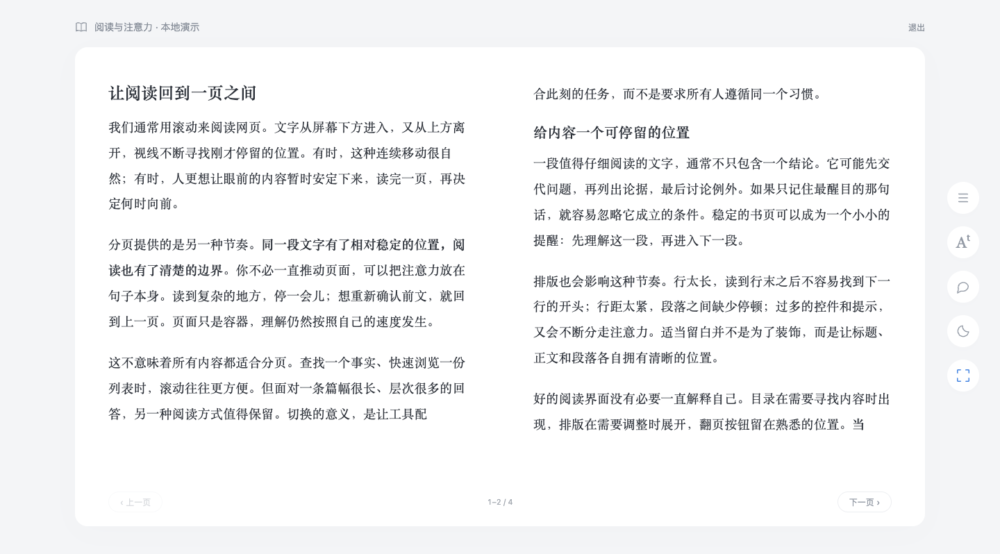
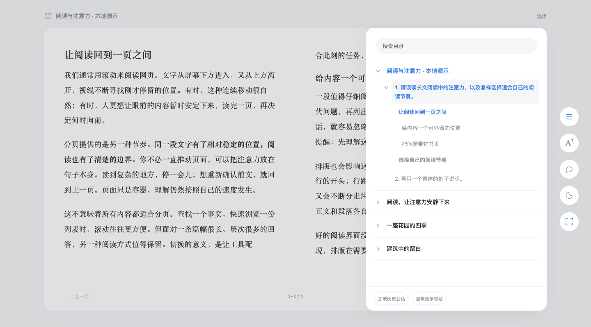

<p align="right"><a href="README.md">中文</a></p>

<p align="center">
  
</p>

<p align="center">
  <a href="https://github.com/holynova/chatgpt-page-reader/releases/latest">⬇ Download Extension</a>
  ·
  <a href="docs/usage.md">Usage Guide</a>
  ·
  <a href="https://github.com/holynova/chatgpt-page-reader">GitHub Repository</a>
</p>

<p align="center">
  <a href="https://github.com/holynova/chatgpt-page-reader/actions/workflows/check.yml"></a>
  <a href="LICENSE"></a>
  
</p>

Answer-to-Book is a Chrome extension (Manifest V3) that turns long ChatGPT answers into a paginated book. Single or double pages, no-flip animation, position preserved across switches; a three-level table of contents (conversation → turn → heading); and follow-up questions asked from inside the book, with each new answer opening on its own page.

## Screenshots

<p align="center">
  
</p>

<p align="center">
  
</p>

> Local demo screenshots, running the same production scripts as the extension.

## Features

- **Paginated reading**: single or double pages, no flip animation; switching pages keeps your place in the text, and each turn keeps its reading position within the tab; narrow windows switch to single page automatically.
- **Three-level contents**: conversation → turn question → answer heading (H1–H6). Regular and project conversations keep loading; archived ones are not read. Searchable, with load-earlier-turns and single-turn reading.
- **Ask inside the book**: expand the composer and send through ChatGPT's native flow; the new answer opens on its own page and streams in. Enter to send, Shift+Enter for a new line; an existing draft in the native box is never overwritten.
- **Typography**: font, size, line height, margins, and light/dark themes; Markdown bold, lists, quotes, code, and tables preserved. System fonts only, nothing to download.
- **Immersive mode**: switch anytime, Escape to exit; the immersive sidebar lists the books of existing conversations and the current answer's chapters.
- **Interface**: the right toolbar, in order, is 目录 contents, 排版 typography, 追问 follow-up, 深色 dark, 沉浸 immersive; contents and typography open as overlay panels — click the backdrop or press Escape to close.

## Install

1. Download the extension ZIP from [Releases](https://github.com/holynova/chatgpt-page-reader/releases/latest) (latest: v0.4.1) and unzip it into a fixed folder.
2. In Chrome, go to `chrome://extensions` and turn on "Developer mode" at the top right.
3. Click "Load unpacked" and select the unzipped folder. `manifest.json` should sit directly inside it.
4. Refresh ChatGPT, then click 「分页阅读」 ("Paginated Reading") at the bottom right, or click the extension icon in the browser toolbar.

To update, replace the files, click "Reload" on the extensions page, and refresh ChatGPT.

## Development

No dependencies to install. `extension/` is the loadable extension directory.

```bash
git clone https://github.com/holynova/chatgpt-page-reader.git
cd chatgpt-page-reader
npm run check     # syntax checks + background-script tests
npm run demo      # local demo: http://127.0.0.1:8766/tests/demo.html?modern
npm run package   # build a distributable extension ZIP
```

[Full usage guide](docs/usage.md) · [Changelog](CHANGELOG.md) · [Browser check records](artifacts/test-results-v4.json)

## Tech

- Manifest V3, zero dependencies, pure vanilla JS; the content script matches only `chatgpt.com` and `chat.openai.com`, and the domain is checked again when the toolbar is injected.
- Only three permissions are requested: `storage`, `activeTab`, `scripting`.

```
extension/
├── manifest.json      Manifest V3, v0.4.1
├── content.js         Reader core: pagination / toolbar / follow-up / immersion
├── paginator.js       Pagination engine: splits pages by text position
├── catalog.js         Three-level contents: conversation → turn → heading
├── composer.js        Follow-up input: hooks into ChatGPT's native send flow
├── styles.js          Typography and themes
├── background.js      Extension icon click → open the reader
└── icons/             16 / 32 / 48 / 128
tests/                 Node tests + browser regression (demo.html local demo)
```

## Scope & Privacy

- Built for ChatGPT web answers on PC Chrome; Canvas, interactive tool cards, attachments, and thinking traces are outside the paginated body.
- Content, contents, and page position stay in the current tab; typography preferences live in browser-local storage, no cross-device sync.
- Follow-ups go through ChatGPT's native input and send flow. The extension has no server of its own, no analytics, and no extra model API.
- ChatGPT redesigns may need adaptation. Contents loading, follow-ups, and pagination have local sample regression checks; full coverage of every real answer layout is not claimed.

## License

[MIT](LICENSE) © 2026 holynova
