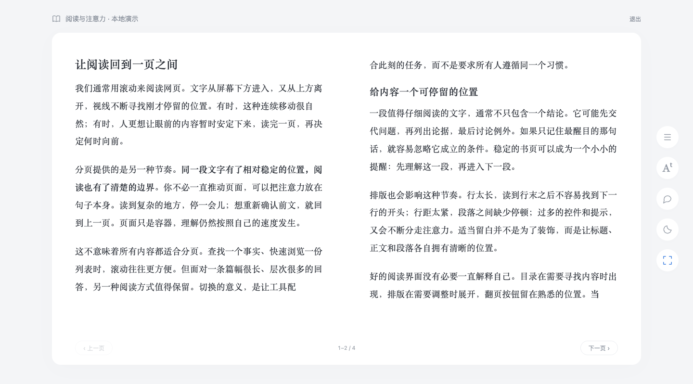
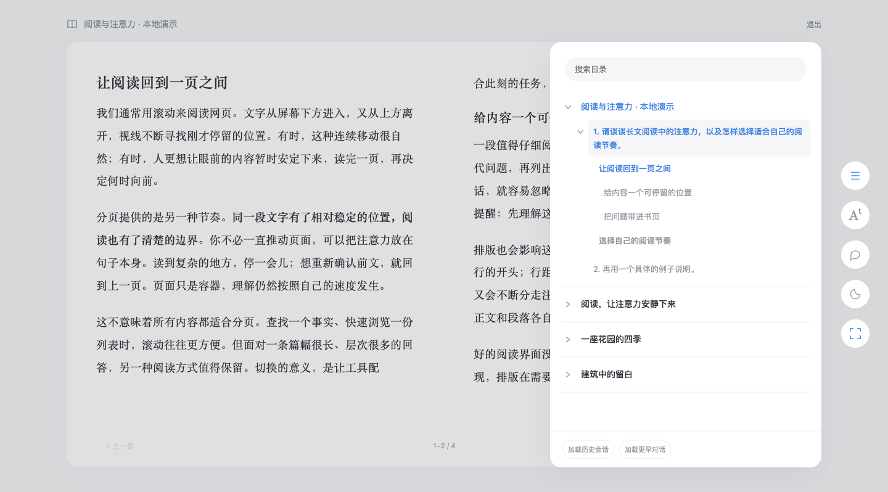

<p align="right"><a href="README.en.md">English</a></p>

<p align="center">
  
</p>

<p align="center">
  <a href="https://github.com/holynova/chatgpt-page-reader/releases/latest">⬇ 下载扩展</a>
  ·
  <a href="docs/usage.md">使用说明</a>
  ·
  <a href="https://github.com/holynova/chatgpt-page-reader">GitHub 仓库</a>
</p>

<p align="center">
  <a href="https://github.com/holynova/chatgpt-page-reader/actions/workflows/check.yml"></a>
  <a href="LICENSE"></a>
  
</p>

回答成书是一款 Chrome 扩展（Manifest V3）：把 ChatGPT 的长回答排成一页一页的书来读。单双页、无动画翻页，切换时定位到当前文字，各轮保留本标签页内的阅读位置；三级目录按会话、轮次、标题导航；还能在书内直接追问，新回答单独进入书页。

## 截图

<p align="center">
  
</p>

<p align="center">
  
</p>

> 本地演示截图，运行与扩展相同的产品脚本。

## 功能

- **分页阅读**：单双页、无动画翻页；切换时定位到当前文字，各轮保留本标签页内的阅读位置；窗口不足以容纳双页时自动切换单页。
- **三级目录**：会话 → 每轮提问 → 回答标题（H1–H6 层次）。普通历史与项目会话可继续加载，归档暂不读取；支持目录搜索、加载更早对话、单轮阅读。
- **书内追问**：展开输入框，通过 ChatGPT 原生流程发送；新回答单独进入书页，跟随流式内容更新。Enter 发送，Shift+Enter 换行；原输入框已有草稿时不会覆盖。
- **阅读排版**：字体、字号、行距、边距与主题（明暗切换）；保留 Markdown 的加粗、列表、引用、代码和表格；字体使用系统字体，无需下载。
- **沉浸模式**：随时切换，Escape 快捷退出；沉浸侧栏提供现有会话书目和当前回答章节。
- **界面**：右侧工具栏依次是目录、排版、追问、深色、沉浸；目录和排版以覆盖面板打开，点击遮罩或按 Escape 收起。

## 安装

1. 在 [Releases](https://github.com/holynova/chatgpt-page-reader/releases/latest) 下载扩展 ZIP（最新版 v0.4.1），解压到固定文件夹。
2. 在 Chrome 地址栏输入 `chrome://extensions`，开启右上角的「开发者模式」。
3. 点击「加载已解压的扩展程序」，选择刚解压的文件夹。文件夹内应直接有 `manifest.json`。
4. 刷新 ChatGPT，点击右下角的「分页阅读」，或点击浏览器工具栏中的扩展图标。

更新时替换文件，在扩展管理页点击「重新加载」，再刷新 ChatGPT。

## 本地开发

无需安装依赖。`extension/` 就是可加载的扩展目录。

```bash
git clone https://github.com/holynova/chatgpt-page-reader.git
cd chatgpt-page-reader
npm run check     # 语法检查 + 后台脚本测试
npm run demo      # 本地演示：http://127.0.0.1:8766/tests/demo.html?modern
npm run package   # 生成可分发的扩展 ZIP
```

[完整使用说明](docs/usage.md) · [更新记录](CHANGELOG.md) · [浏览器检查记录](artifacts/test-results-v4.json)

## 技术

- Manifest V3，零依赖，纯原生 JS；内容脚本只匹配 `chatgpt.com` 与 `chat.openai.com` 两个域名，工具栏注入时再次检查域名。
- 请求的权限只有 `storage`、`activeTab`、`scripting` 三项。

```
extension/
├── manifest.json      Manifest V3，v0.4.1
├── content.js         阅读器主逻辑：分页 / 工具栏 / 追问 / 沉浸
├── paginator.js       分页引擎：按文字位置切页
├── catalog.js         三级目录：会话 → 轮次 → 标题
├── composer.js        追问输入：接 ChatGPT 原生发送流程
├── styles.js          排版与主题
├── background.js      扩展图标点击 → 打开阅读器
└── icons/             16 / 32 / 48 / 128
tests/                 Node 测试 + 浏览器回归（demo.html 本地演示）
```

## 范围与数据

- 面向 PC Chrome 的 ChatGPT 网页回答；Canvas、交互工具卡片、附件和思考过程不在正文分页范围内。
- 正文、目录与书页位置只在当前标签页内处理；排版偏好存于浏览器本地，不跨设备同步。
- 追问交给 ChatGPT 原生输入和发送流程。本扩展没有自己的服务端、分析统计或额外模型 API。
- ChatGPT 改版可能需要适配。目录加载、追问和分页有本地样例回归检查；不声称覆盖所有真实回答布局。

## 许可

[MIT](LICENSE) © 2026 holynova
