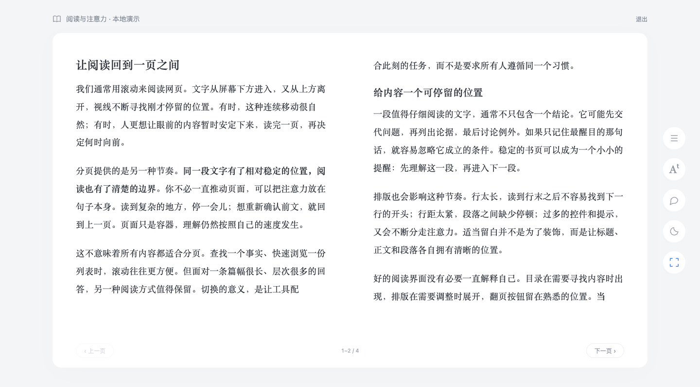
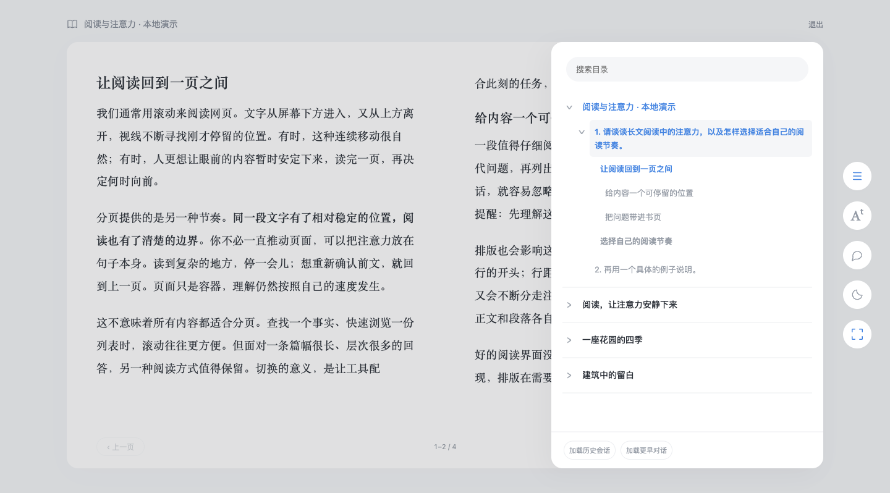
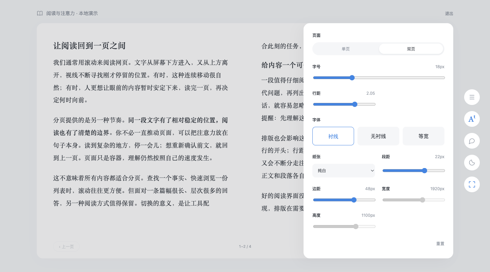
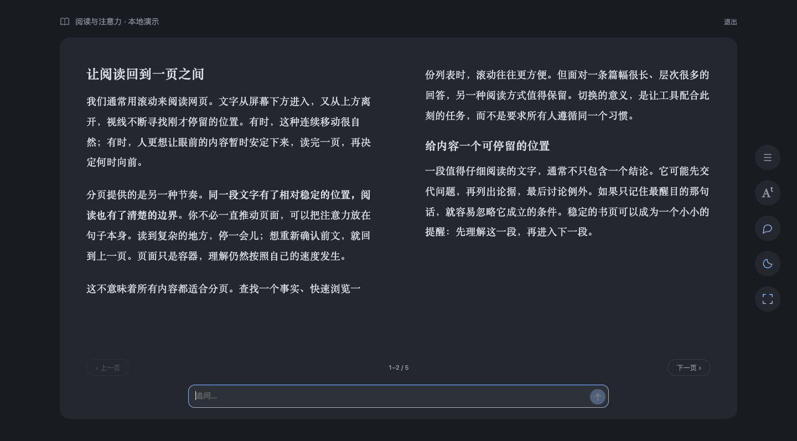

<div align="center">
  
  <h1>回答成书</h1>
  <p>把 ChatGPT 的长回答，翻成一页一页的书。</p>
  <p>
    <a href="https://github.com/holynova/chatgpt-page-reader/releases/latest">下载扩展</a> ·
    <a href="#安装">安装</a> ·
    <a href="docs/usage.md">使用说明</a>
  </p>
  <p>
    <a href="https://github.com/holynova/chatgpt-page-reader/actions/workflows/check.yml"></a>
    <a href="LICENSE"></a>
    
  </p>
</div>



*本地演示截图，运行与扩展相同的产品脚本。*

- **分页阅读**：单双页、无动画翻页；切换时定位到当前文字，各轮保留本标签页内的阅读位置。
- **三级目录**：会话 → 每轮提问 → 回答标题。普通历史与项目会话可继续加载，归档暂不读取。
- **书内追问**：展开输入框，通过 ChatGPT 原生流程发送；新回答单独进入书页。
- **阅读排版**：字体、字号、行距、边距与主题。保留 Markdown 的加粗、列表、引用、代码和表格。

## 安装

1. 在 [Releases](https://github.com/holynova/chatgpt-page-reader/releases/latest) 下载扩展 ZIP，解压到固定文件夹。
2. 在 Chrome 地址栏输入 `chrome://extensions`，开启右上角的「开发者模式」。
3. 点击「加载已解压的扩展程序」，选择刚解压的文件夹。文件夹内应直接有 `manifest.json`。
4. 刷新 ChatGPT，点击右下角的「分页阅读」，或点击浏览器工具栏中的扩展图标。

更新时替换文件，在扩展管理页点击「重新加载」，再刷新 ChatGPT。

## 界面

右侧工具栏依次是 **目录、排版、追问、深色、沉浸**。目录和排版以覆盖面板打开，保留书页的排版宽度；点击遮罩或按 Escape 收起。

<details>
<summary>目录：按会话、轮次和 Markdown 标题导航</summary>



一级包含普通与项目会话；二级以每轮提问命名；三级保留 H1–H6 的层次。点击某轮只阅读该轮回答，点击标题跳到对应内容。

「加载历史会话」沿用原侧栏的滚动、项目展开和「展开显示」控件。「加载更早对话」读取当前会话的早期轮次。界面显示实际读取数量；原生页面暂未返回的历史可以继续加载。

</details>

<details>
<summary>排版：留白、字体与单双页</summary>



字体使用系统字体，不需要下载字体。窗口不足以容纳双页时自动切换单页。

</details>

<details>
<summary>追问与深色模式</summary>



Enter 发送，Shift+Enter 换行。原输入框已有草稿时不会覆盖。展开追问会为输入框留出空间，正文不会被遮挡。

</details>

## 本地开发

无需安装依赖。`extension/` 就是可加载的扩展目录。

```sh
git clone https://github.com/holynova/chatgpt-page-reader.git
cd chatgpt-page-reader
npm run check
npm run demo
```

打开 `http://127.0.0.1:8766/tests/demo.html?modern` 运行本地演示。`npm run package` 生成可分发的扩展 ZIP。

[完整使用说明](docs/usage.md) · [更新记录](CHANGELOG.md) · [浏览器检查记录](artifacts/test-results-v4.json)

## 范围与数据

- 面向 PC Chrome 的 ChatGPT 网页回答；Canvas、交互工具卡片、附件和思考过程不在正文分页范围内。
- 正文、目录与书页位置只在当前标签页内处理；排版偏好存于浏览器本地，不跨设备同步。
- 追问交给 ChatGPT 原生输入和发送流程。本扩展没有自己的服务端、分析统计或额外模型 API。
- 请求 `storage`、`activeTab`、`scripting`；脚本只匹配两个 ChatGPT 域名，工具栏注入时再次检查域名。
- ChatGPT 改版可能需要适配。目录加载、追问和分页有本地样例回归检查；不声称覆盖所有真实回答布局。

## 许可证

[MIT](LICENSE) © 2026 holynova
