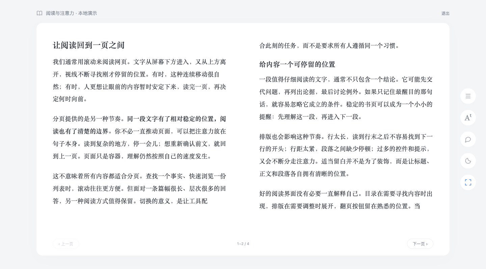
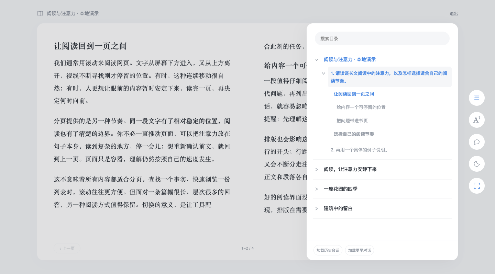

# 回答成书

把 ChatGPT 网页中的**一条回答**，重新排成可翻页的书籍。适用于 PC Chrome，版本 0.4.0。



## 安装

1. 在 Chrome 地址栏输入 `chrome://extensions`，开启右上角的「开发者模式」。
2. 点击「加载已解压的扩展程序」，选择本项目的 **`extension` 文件夹**，不要选择整个项目，也不要直接选择 ZIP。
3. 刷新已打开的 ChatGPT 页面。在任意阅读位置点击右下角「分页阅读」，或点击 Chrome 工具栏的插件图标。

从旧版升级：在扩展管理页点击本插件的「重新加载」，再刷新 ChatGPT 页面。v0.2.0 新增了脚本文件，仅刷新网页不足以完成升级。

选择项目内的 `extension` 文件夹。

也可以将 `artifacts/chatgpt-page-reader-0.4.0.zip` 解压到一个固定位置，再选择解压后的目录加载。移动或删除已加载的文件夹，会影响扩展运行。

## 使用

- 固定悬浮入口和 Chrome 工具栏入口，选择当前可见的单条回答；不包含提问，不会合并其他回答。
- 从当前可见文字位置进入书页；退出时返回对应文字位置。翻页后退出，会跟随新的阅读进度。
- 普通模式占据主内容区，保留原侧边栏；退出后回到原回答文字位置。
- 右侧工具栏提供目录、排版、追问、深色和沉浸切换；图标悬停可见名称。Escape 先关闭面板，再退出沉浸模式。
- 目录以覆盖面板打开，不压缩正文宽度，支持搜索。它是统一的可折叠树：一级是会话，二级是每轮用户问题与回答，三级是该回答的 Markdown 标题。H1–H6 保留原始级别并递进缩进。点击轮次或标题只阅读对应回答。
- 一级包括普通历史和项目中的会话，归档暂不读取。「加载历史会话」沿用 ChatGPT 原侧栏的滚动、项目展开和「展开显示」控件；结束或停止后恢复原来的折叠与滚动状态。
- 未访问的会话按需进入并读取轮次；「加载更早对话」通过原对话的顶部滚动加载早期轮次。已读取的轮次和各轮书页位置在本标签页内保留，原网页虚拟化移除节点后仍可从目录继续阅读。
- 加载状态显示实际读取数量。原生界面未继续返回记录时会停止；不会将一次未增长的结果标成“全量完整”，可继续加载。
- 点击右侧的对话图标展开书内追问。Enter 发送，Shift+Enter 换行。使用 ChatGPT 原生输入和发送流程，不调用额外 API。新回答会独立接入书内，并跟随流式内容更新。
- 原输入框已有草稿时，不会覆盖；书内草稿在当前页面内保留，不写入扩展存储。
- 单页或双页显示；可用空间不足 800px 时自动单页。
- 点击上一页 / 下一页，或使用左右方向键、PageUp / PageDown；无动画，也不会随翻页移动网页。编辑输入框时不会拦截这些按键。
- 点击 Aᵗ 展开右侧排版面板，支持字体、字号、行距、段落间距、页边距、阅读区域宽度、书页高度，以及暖纸、纯白、夜间主题。字体来自系统，未安装的字体按系统回退。
- 保留加粗、斜体、删除线、标题、列表、引用、行内代码、代码块、链接和表格。新版 ChatGPT 的样式化文本会转换为标准语义标签；跨页时仍保持格式。
- 图片整体适配书页，可点击放大；普通长表格按行跨页并重复表头；过宽表格与代码块允许局部横向滚动。
- 点击书页上方「退出」或 Chrome 工具栏图标，退出这一条回答的分页模式。
- 如果回答仍在生成或被修改，工具栏会出现「更新」。点击后重新提取，不会在阅读中自动跳动。

## 范围与验证

- 支持 `chatgpt.com` 与 `chat.openai.com` 下的标准回答正文。支持当前的 `[data-markdown-text-style="assistant-message"]` 结构与旧版回答节点 / `.markdown` 结构，ChatGPT 改版后可能需要适配。
- 已读取真实 ChatGPT 页面确认回答、编辑器、发送按钮与会话链接的结构；用户已确认 v0.1.1 入口及分页可用。v0.4.0 的分页、三级目录、格式保留、追问和导航以本地合成样例验证，未向用户真实会话发送测试问题。工具栏后台流程使用模拟 Chrome API 检查。
- 动态工具卡片、Canvas、交互图表、音视频、附件与思考过程不属于第一版正文范围；不把它们截图塞进书页。
- 超高单行表格、跨行合并单元格等无法安全分页的对象，保留为带提示的局部滚动区域，以免改变表格含义。
- 尽力保留正文文字、链接、标题、列表、代码、图片、表格与 MathML。没有导出为 EPUB/PDF，也没有跨设备同步。
- 改字号、尺寸或模式后重新分页，按正文文字位置定位；不保证页码相同。不保存跨刷新阅读进度。
- 宽高设置用于普通模式；沉浸模式自动占满当前窗口。历史由 ChatGPT 原生界面按需加载，不调用未公开的历史 API，不读取归档。项目与普通侧栏出现的同一会话按会话 ID 去重。
- 原网页虚拟化尚未载入对应轮次时，退出的原文定位取决于 ChatGPT 当前挂载的节点；该轮的书页位置仍保留在标签页内，可从目录继续。
- 「双页」是两页正文并排，不添加封面或将首屏强制留作扉页。



## 数据与权限

请求 `storage`、`activeTab`、`scripting` 权限，静态内容脚本只匹配两个 ChatGPT 域名。点击工具栏图标时可为安装前打开的标签页补注入本地脚本；后台会再次检查域名，不对其他网站注入。使用 Manifest V3，后台仅处理工具栏启动，无账号、远程代码、分析统计或上传接口。

正文在当前网页中克隆、排版；本标签页读取到的会话标题、轮次与回答节点仅在内存缓存，用于目录导航和虚拟化后的继续阅读，不写入扩展存储；仅排版偏好保存在 `chrome.storage.local`，不启用同步。会话切换时，页面 `sessionStorage` 暂存目标路径、模式和时间，以便跨页面导航后恢复阅读模式；不保存正文。用户点击发送的追问由 ChatGPT 原生流程提交给 ChatGPT，本插件没有自己的服务端。图片继续使用原图地址，图片资源可能由浏览器正常加载；点击原文链接会打开对应网站。

## 本地演示与检查

无需构建或安装依赖，`extension` 就是实际加载目录。

```sh
npm run check
npm run demo
```

打开 `http://127.0.0.1:8766/tests/demo.html`。这是有明显标识的本地合成样例，直接载入同一份产品脚本，**不是已安装扩展的真实 ChatGPT 截图**。

浏览器控制台运行：

```js
await runReaderTests();
await runReaderEdgeTests();
await runReaderProgressTests();
await runImmersiveTests();
await runCatalogTests();
await runLayoutTests();
```

在 URL 后加 `?modern` 可测试不含旧版标记的新回答结构。

核心检查验证逐页正文顺序与完整性、代码空格与换行、表格行顺序、独立回答、方向键、恢复原文、设置存储和动态回答。边界检查覆盖宽窄窗口、图片放大、滚动位置、危险属性过滤及复杂表格。

实际执行结果记录于 `artifacts/test-results-v4.json`；当前检查环境与未完成项目也记录在该文件中。

```sh
npm run package
```

ZIP 根目录包含 `manifest.json` 和运行脚本，不包含测试、截图或其他材料。未上传 Chrome 应用商店。

实现依据：[Chrome 内容脚本文档](https://developer.chrome.com/docs/extensions/develop/concepts/content-scripts)。阅读界面的单双页与排版设置参考微信读书网页版的交互方向，未复制其代码或视觉资产。
